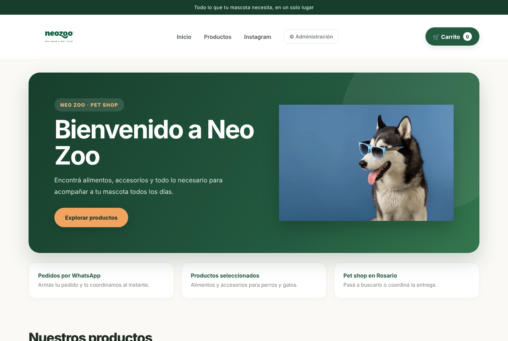
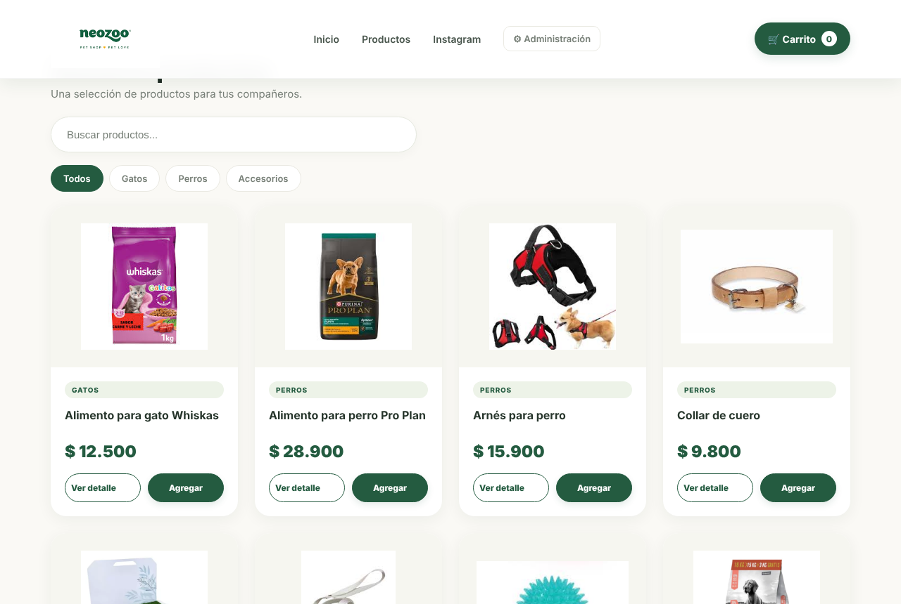
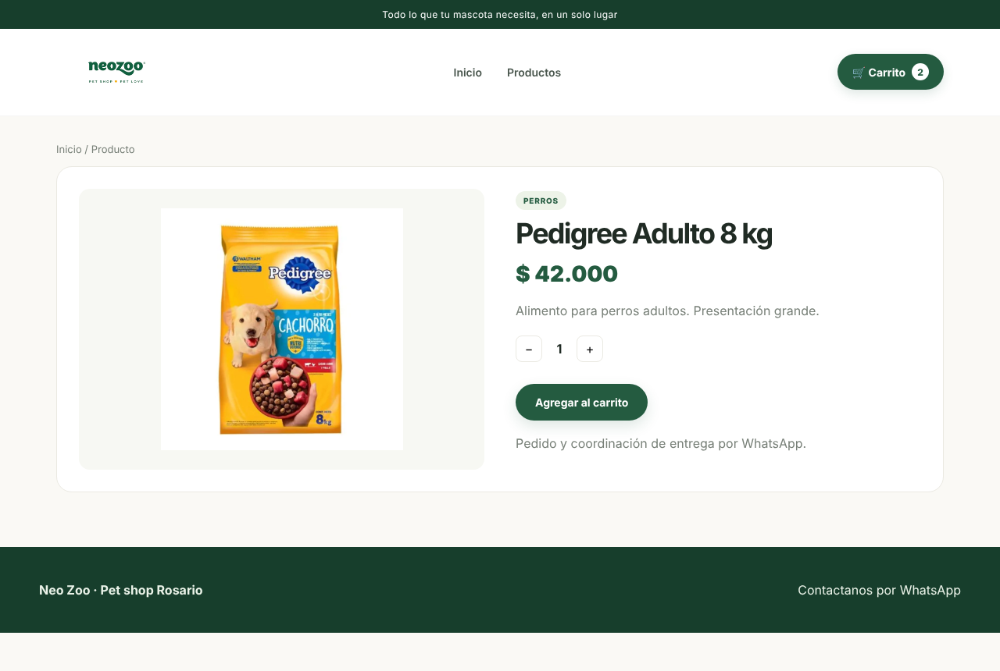
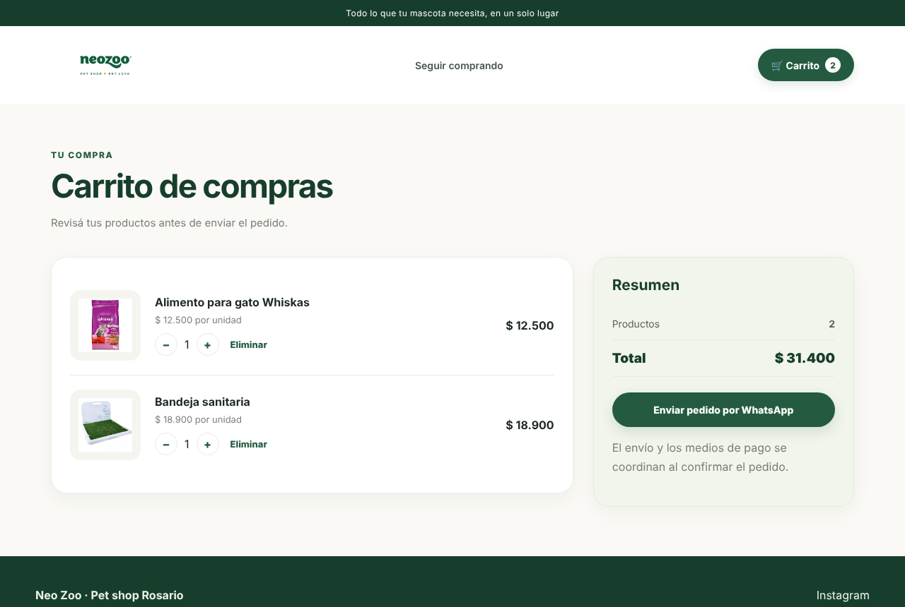
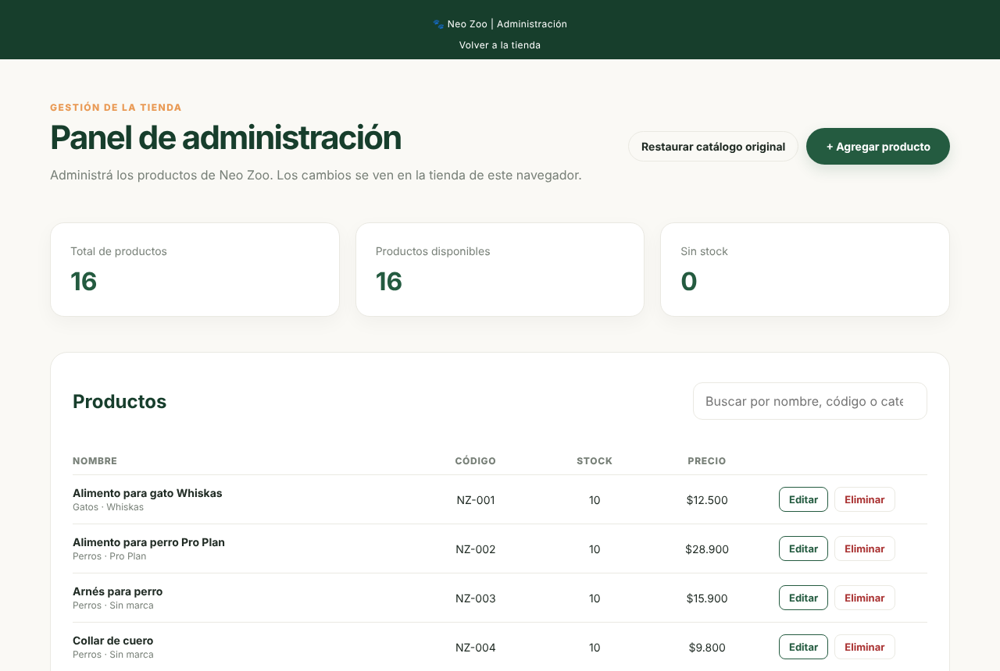
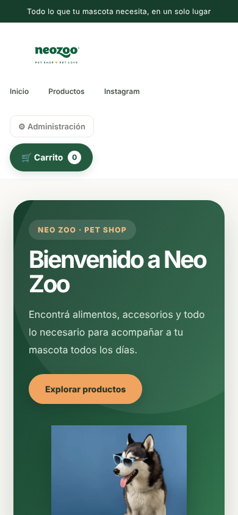

# Neo Zoo · Tienda online de mascotas

Sitio web de una pet shop de Rosario, desarrollado con HTML, CSS y JavaScript puro. Incluye catálogo con filtros y búsqueda, carrito de compras, pedido por WhatsApp, panel de administración y ofertas rotativas.

> Proyecto de portfolio. No tiene backend ni base de datos: todo funciona en el navegador.

## Capturas

| Inicio (escritorio) | Catálogo |
|---|---|
|  |  |

| Detalle de producto | Carrito |
|---|---|
|  |  |

| Panel de administración | Versión móvil |
|---|---|
|  |  |

## Funcionalidades

- **Inicio con carrusel de promociones**: banners que rotan solos, con botones para cambiar de slide manualmente.
- **Catálogo**: grilla responsive con buscador de texto y filtro por categoría (Perros, Gatos, Accesorios).
- **Detalle de producto**: imagen, descripción, precio y botón para agregar al carrito.
- **Carrito**: cantidades editables, cálculo del total y acceso al pedido por WhatsApp. Se guarda en `localStorage`, así que sobrevive a recargas.
- **Productos sin stock**: se muestran con el botón deshabilitado.
- **Panel de administración** (`admin.html`): alta, edición y baja de productos; búsqueda; estadísticas de stock; carga de imagen con arrastrar y soltar (se reduce automáticamente antes de guardarse); restauración del catálogo original.
- **Producto de prueba**: un formulario de demostración crea un producto que existe solo en la pestaña actual y se borra al cerrarla (`sessionStorage`).
- **Diseño adaptable**: funciona en escritorio y celular, y respeta la preferencia de movimiento reducido del sistema.

## Tecnologías

- HTML5 semántico
- CSS3 con variables personalizadas, Grid, Flexbox y animaciones con `@keyframes`
- JavaScript (ES2020) sin frameworks ni dependencias de terceros
- Web Storage API: `localStorage` (carrito y catálogo editado) y `sessionStorage` (productos de prueba)

## Cómo ejecutarlo

No requiere instalación ni compilación.

**Opción 1: Live Server (VS Code)**
1. Clonar el repositorio: `git clone https://github.com/Gabriel-Trevisan12/neo-zoo.git`
2. Abrir la carpeta en VS Code.
3. Hacer clic derecho en `index.html` → **Open with Live Server**.

**Opción 2: servidor local con Python**
```bash
cd neo-zoo
python -m http.server 8080
```
Luego abrir `http://localhost:8080`.

El panel de administración está en `http://localhost:8080/admin.html`.

## Estructura del proyecto

```
neo-zoo/
├── index.html          # Inicio: carrusel, catálogo y filtros
├── producto.html       # Detalle de producto (lee ?id= de la URL)
├── carrito.html        # Carrito y resumen del pedido
├── admin.html          # Panel de administración
├── css/
│   └── styles.css      # Estilos de todo el sitio
├── js/
│   ├── app.js          # Catálogo, carrito, render de páginas y formulario de prueba
│   └── admin.js        # Lógica del panel de administración
└── img/                # Fotos de productos y logo
```

## Datos y configuración

- **Catálogo**: los productos iniciales están en el array `PRODUCTOS` de `js/app.js`. Cada producto tiene `id`, `name`, `category`, `brand`, `price`, `image`, `description`, `stock` y `sku`.
- **Número de WhatsApp**: constante `WHATSAPP_NUMBER` en `js/app.js`.
- **Claves de almacenamiento**:

| Clave | Almacén | Contenido |
|---|---|---|
| `neozoo-cart` | `localStorage` | Carrito |
| `neozoo-catalogo` | `localStorage` | Catálogo editado desde el panel |
| `neozoo-demo-productos` | `sessionStorage` | Productos de prueba de la sesión |

Los cambios del panel se guardan en el navegador donde se hicieron. Para volver al catálogo original, usar **Restaurar catálogo original** en el panel.

## Limitaciones

- No hay pagos en línea: el pedido se completa por WhatsApp.
- No hay backend ni base de datos, por lo que los cambios del panel no se comparten entre dispositivos ni navegadores.
- El panel de administración no tiene autenticación. Está pensado como demostración de la interfaz, no como herramienta de producción.

## Próximos pasos

- Reconstruir la interfaz con React.
- Agregar un backend con base de datos y autenticación para el panel.
- Integrar un proveedor de pagos.

## Autor

**Gabriel Trevisan** · [GitHub](https://github.com/Gabriel-Trevisan12)
